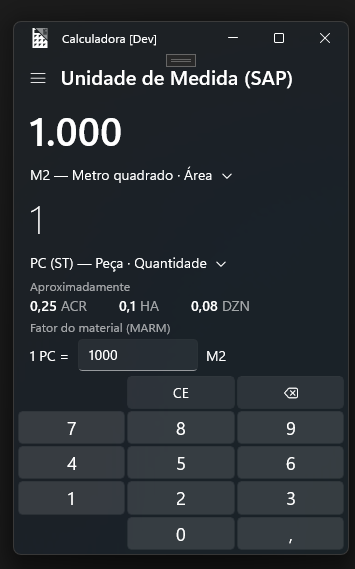
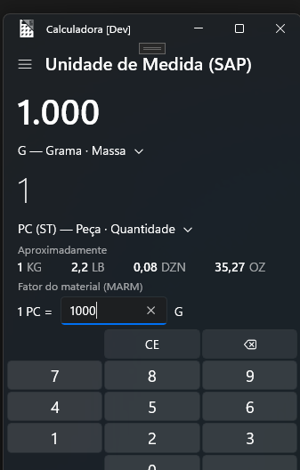

# Calculadora SAP

**Calculadora do Windows com conversor de Unidades de Medida do SAP (MEINS)** — feita para quem trabalha com SAP MM, EWM e Master Data e precisa converter unidades rapidamente, sem abrir o sistema.

> ⚠️ **Projeto não oficial.** Este é um fork da [Windows Calculator](https://github.com/microsoft/calculator) (open source, licença MIT). Não é um produto da Microsoft e não tem vínculo com a SAP SE. "SAP" é usado apenas para descrever a finalidade da ferramenta.

<p>
  
  &nbsp;&nbsp;
  
</p>

## O que tem de novo

### Conversor "Unidade de Medida (SAP)"

Novo tipo de conversor no menu, logo acima de **Moeda**, com as unidades padrão da tabela **T006** (transação **CUNI**), agrupadas por dimensão como no SAP:

| Dimensão | Unidades |
|---|---|
| Massa | MG, G, KG, TO, OZ, LB, TON |
| Volume | MM3, ML, CM3 (CCM), L, DM3 (CDM), HL, M3, IN3, PT, QT, GAL (GLL), GLI, FT3, YD3 |
| Comprimento | µM (MIM), MM, CM, DM, M, KM, IN, FT, YD, MI |
| Área | MM2 (MMK), CM2, DM2, M2, HA (HAR), KM2 (KMK), IN2, FT2, YD2, ACR, MI2 |
| Quantidade | PC (ST), DZN, GRO |
| Proporção | %, ‰, PPM |
| Tempo | MS, S, MIN, H, DAY (TAG), WK (WCH), MON, YR (JHR) |
| Temperatura | °C (CEL), °F (FA), K |
| Energia | J, KJ, MJ, KWH |
| Potência | W, KW, MW |
| Pressão | PA, MBAR, KPA, PSI, BAR |
| Velocidade | KM/H, M/S |

Cada unidade aparece como **código externo (código interno) — descrição · dimensão**, por exemplo `PC (ST) — Peça · Quantidade`, para você enxergar exatamente o que fica gravado no campo **MEINS**.

Exemplo: `1000 G = 1 KG`, `1 DZN = 12 PC`, `1 HL = 100 L`.

### Fator do material (estilo MARM)

No SAP, conversões entre dimensões diferentes (ex.: **M2 → PC** ou **G → PC**) dependem do material e ficam na **MARM** (MM03 › Unidades de medida alternativas). A calculadora reproduz isso:

1. Escolha duas unidades de dimensões diferentes (ex.: `M2` → `PC`).
2. Aparece o campo **Fator do material (MARM)**: `1 PC = [ 1000 ] M2`.
3. Pronto — `1000 M2 = 1 PC`, e o fator vale para todas as unidades das mesmas dimensões (HA, FT2, DZN...).

Dá para ter vários fatores ao mesmo tempo (ex.: `1 PC = 1000 M2` e `1 PC = 1000 G`). Para remover, basta apagar o campo.

> Os fatores ficam ativos enquanto o app estiver aberto.

### Tema azul

Visual da calculadora ajustado para o azul, inspirado na identidade do SAP.

## Como compilar

Pré-requisitos (iguais ao projeto original):

- Windows 11 (build 22000 ou superior).
- [Visual Studio](https://visualstudio.microsoft.com/) com a carga de trabalho **Desenvolvimento para a Plataforma Universal do Windows** e o componente opcional **Ferramentas da Plataforma Universal do Windows para C++**.
- Windows 11 SDK mais recente.

Passos:

```
git clone https://github.com/devbispojunio/calculadora-sap.git
```

1. Abra `src\Calculator.slnx` no Visual Studio.
2. Selecione **Debug | x64** e o projeto **Calculator** como inicialização.
3. **Build › Rebuild Solution** e depois **F5**.

## Onde está o código

| Arquivo | O que faz |
|---|---|
| `src/Calculator.ViewModels/DataLoaders/SapUnitsOfMeasure.cs` | Tabela das unidades SAP (código interno/externo, dimensão e fator para o SI). Para incluir uma unidade Z, basta adicionar uma linha. |
| `src/Calculator.ViewModels/DataLoaders/UnitConverterDataLoader.cs` | Carrega as unidades no motor de conversão e calcula os fatores do material. |
| `src/Calculator.ViewModels/UnitConverterViewModel.cs` | Lógica do campo "Fator do material". |
| `src/Calculator/Views/UnitConverter.xaml` | Tela do conversor (campo do fator). |
| `src/Calculator.ViewModels/Common/NavCategory.cs` | Novo item "Unidade de Medida (SAP)" no menu. |

## Observações

- Os códigos e fatores seguem o padrão da T006. Se o seu sistema tiver unidades customizadas (Z) ou códigos diferentes, confira na **CUNI** e ajuste o `SapUnitsOfMeasure.cs`.
- Unidades de embalagem (CX, PAL, FD...) não têm fator fixo — use o **Fator do material**.
- O mês (MON) é considerado 30 dias e o ano (YR) 365 dias.
- Telemetria: os eventos de diagnóstico (TraceLogging) herdados do projeto original estão desativados neste fork; o app não envia dados para ninguém.

## Créditos e licença

- Baseado na [Windows Calculator](https://github.com/microsoft/calculator) — Copyright (c) Microsoft Corporation, licença MIT. O README original está em [docs/README-original.md](docs/README-original.md).
- Conversor SAP e fator do material: **Junio Garcia Bispo**.
- Distribuído sob a licença [MIT](LICENSE).
